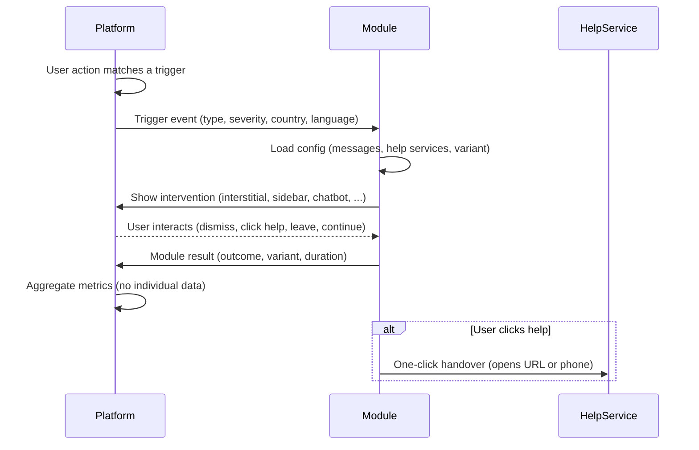

# Plug-in contract

This document defines the interface between a **platform** (the website that shows a warning) and a **module** (the code your team builds). Every team's module should follow this contract so it can plug into the mock platform — and into real platforms the same way.

## Lifecycle



## The four event types

### 1. Trigger event (platform → module)

Fired when the platform detects a trigger. In the mock platform, this happens when a user types a `test-trigger-*` term in the search box or chat panel.

| Field | Type | Required | Description |
|-------|------|----------|-------------|
| `type` | `"search"` \| `"chat"` \| `"navigation"` | yes | How the trigger was detected |
| `severity` | `"low"` \| `"medium"` \| `"high"` | yes | How urgently to interrupt |
| `country` | string | yes | ISO 3166-1 alpha-2 (e.g. `"NL"`) |
| `language` | string | yes | BCP 47 tag from the browser (e.g. `"nl"`, `"en"`) |
| `platformType` | string | no | E.g. `"forum"`, `"chat"`, `"adult"`, `"search"` |
| `timestamp` | ISO 8601 string | yes | When the trigger fired |
| `sessionScopedId` | string | no | Random, regenerated per session, **never persisted** |

**No query text is ever passed to the module.** The module does not know what the user searched for — only that a trigger was matched and at what severity.

Schema: [`schemas/trigger-event.schema.json`](schemas/trigger-event.schema.json)

### 2. Module config

Configuration that tells the module what to show. Can be loaded from a static JSON file, from the starter backend (`GET /config`), or hardcoded during the hackathon.

| Field | Type | Required | Description |
|-------|------|----------|-------------|
| `country` | string | yes | ISO 3166-1 alpha-2 |
| `language` | string | yes | BCP 47 |
| `variant` | string | no | A/B variant id (e.g. `"control"`, `"deterrent-v2"`) |
| `tone` | `"deterrent"` \| `"therapeutic"` \| `"mixed"` | no | Overall tone |
| `helpServices` | array | no | Services to show for this country |
| `messageBlocks` | array | no | Message blocks filtered for language and tone |

Schema: [`schemas/module-config.schema.json`](schemas/module-config.schema.json)

### 3. Module result (module → platform)

Reported back after the intervention is shown, so the platform can aggregate metrics.

| Field | Type | Required | Description |
|-------|------|----------|-------------|
| `shown` | boolean | yes | Was the intervention displayed? |
| `variantId` | string | no | Which variant was shown |
| `outcome` | `"dismissed"` \| `"clicked_help"` \| `"left_page"` \| `"continued"` \| `"timeout"` | yes | What the person did |
| `helpServiceId` | string \| null | no | Which service was clicked (if any) |
| `durationMs` | integer | no | How long the intervention was visible |
| `timestamp` | ISO 8601 string | yes | When the result was recorded |

Schema: [`schemas/module-result.schema.json`](schemas/module-result.schema.json)

### 4. Metrics event (aggregate)

Aggregated counts for a time period. **No individual identifiers.** Used by the dashboard and by `POST /metrics` on the starter backend.

| Field | Type | Required | Description |
|-------|------|----------|-------------|
| `period` | `{ start, end }` | yes | Time window |
| `variantId` | string | no | Which variant |
| `counts` | object | yes | `{ triggers, shown, dismissed, clicked_help, left_page, continued, timeout }` |
| `suppressedSmallCounts` | boolean | no | True if any count was below 10 and hidden |

**Small-count suppression:** any individual count below 10 is reported as `null` or omitted. This prevents re-identification in small populations.

Schema: [`schemas/metrics-event.schema.json`](schemas/metrics-event.schema.json)

---

## How to integrate: the mock platform

The mock platform fires trigger events as `CustomEvent`s on `document.body`:

```js
// The platform fires this:
document.body.dispatchEvent(new CustomEvent('sbis:trigger', {
  detail: {
    type: 'search',
    severity: 'high',
    country: 'NL',
    language: navigator.language.split('-')[0] || 'en',
    timestamp: new Date().toISOString(),
    sessionScopedId: crypto.randomUUID()
  }
}));
```

Your module listens for this event:

```js
// Your module listens:
document.body.addEventListener('sbis:trigger', (event) => {
  const trigger = event.detail;
  // Show your intervention based on trigger.severity, trigger.country, etc.
});
```

When the interaction is complete, your module fires a result event:

```js
// Your module reports back:
document.body.dispatchEvent(new CustomEvent('sbis:result', {
  detail: {
    shown: true,
    variantId: 'my-variant',
    outcome: 'clicked_help',
    helpServiceId: 'offlimits-preventielijn',
    durationMs: 4200,
    timestamp: new Date().toISOString()
  }
}));
```

## How to swap in your module

In the mock platform's `index.html`, change the script tag:

```html
<!-- Replace this line: -->
<script type="module" src="/starter-widget/widget.js"></script>

<!-- With your module: -->
<script type="module" src="/your-team/your-module.js"></script>
```

That is a one-line change. Your module just needs to listen for `sbis:trigger` and fire `sbis:result`.

---

## How a platform integrates this in 15 minutes

For a real platform (not the mock), the integration looks like this:

### Step 1: Add the script tag (2 minutes)

```html
<script src="https://your-cdn.example/sbis-widget.js"
        data-country="NL"
        data-language="nl"
        async>
</script>
```

### Step 2: Fire trigger events from your detection logic (10 minutes)

Your platform already knows when to show a warning (from your existing moderation or keyword matching). When that happens, fire the trigger event:

```js
document.body.dispatchEvent(new CustomEvent('sbis:trigger', {
  detail: {
    type: 'search',
    severity: 'high',
    country: 'NL',
    language: 'nl',
    timestamp: new Date().toISOString()
  }
}));
```

### Step 3: Optionally collect aggregate metrics (3 minutes)

Listen for result events and POST them to your own analytics:

```js
document.body.addEventListener('sbis:result', (event) => {
  // Aggregate locally, then send batch
  fetch('/api/metrics', {
    method: 'POST',
    body: JSON.stringify(event.detail)
  });
});
```

---

## Privacy guarantees

1. **No query text** is passed from platform to module.
2. **No persistent user IDs.** The `sessionScopedId` is random and regenerated each session.
3. **No cookies, no fingerprinting, no IP logging** in the module.
4. **Aggregate-only metrics.** Individual events are counted, not stored.
5. **Small-count suppression.** Any metric count below 10 is hidden.

These are not just rules for the hackathon — they are design principles for the production system.
